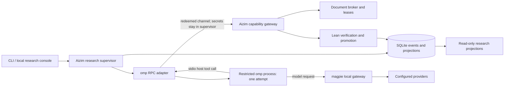

# Aizim on omp and magpie

Date: 2026-11-08
Status: accepted direction; implementation contract

## Decision

Aizim remains an independent, local formal-research supervisor. It launches one restricted omp
RPC process per research attempt. magpie owns provider credentials, model selection, routing,
fallback, and request usage. Aizim does not implement another provider gateway.

omp is not the research authority and magpie is not a task scheduler. Neither an omp prompt result,
an assistant summary, a routing decision, nor a human review can mark a mathematical target verified.
Only the trusted Lean publication path can do that.

The product has one public autonomous workflow: `aizim research …`. The former Codex/Claude
Controller, Worker registration, one-assignment execution path, and provider-specific controller
configuration are removed rather than maintained as aliases. Existing events remain replayable and
old research exports remain interpretable; old execution identities are never rewritten.

## Topology

## Responsibilities

### Aizim research supervisor

- Own target immutability, dependency readiness, bounded attempts, pause/resume, cancellation,
  timeouts, resource limits, restart recovery, and durable research records.
- Materialize an immutable target context, verified dependency declarations, bounded prior feedback,
  advisory memory, and operator guidance for one attempt.
- Issue per-attempt worker/run/lease identities. Redeem the gateway session inside the trusted Python
  supervisor; do not pass its raw capability token or broker session id to omp.
- Expose only role-authorized gateway operations as RPC host tools. Validate JSON Schema at the RPC
  boundary and validate capability, operation, run, worker, lease, expiry, and revocation again in the
  existing gateway.
- Disable omp built-in tools, ambient extensions, skills, rules, context files, MCP configuration,
  and interactive UI for autonomous attempts. Use an explicit cwd and isolated per-attempt session
  storage. Do not allow model-controlled subagents to escape the attempt boundary.
- Treat all RPC events and final assistant messages as untrusted telemetry. Bound frames, reassemble
  protocol v2 chunks exactly, correlate requests, forward cancellation, terminate the child on
  timeout, and retain an untrusted transport digest.

### omp

- Execute one research attempt through `omp --mode rpc --no-ui --no-tools --no-extensions
  --no-skills --no-rules --no-context-files`.
- Receive a complete prompt and host-owned tool definitions over stdio. Invoke those tools through
  `host_tool_call`; never receive authority to append state or publish directly.
- Use the model selected by the magpie-managed omp configuration. Aizim records the resolved model,
  omp version, and executable identity observed for the attempt.
- A completed or yielded prompt is only the end of Agent work. Publication settlement is a separate
  wait on trusted events.

### magpie

- Own provider accounts, credentials, model catalog, routing groups, fallback, quotas, and provider
  request telemetry.
- Serve the local gateway used by omp. Aizim readiness checks require a responding gateway and an
  available omp model, but do not inspect or copy provider credentials.
- magpie usage may supplement display only when correlated without ambiguity. It does not replace
  per-attempt usage observed through omp and never settles a research attempt.

### Trusted formal and research core

Retain the existing StateService, event store and projections, document leases, CapabilityGateway,
Lean runtime and promotion services, research record rules, search, and local export. These are
provider-independent responsibilities.

A target is verified only when a `DeclarationPublished` event is bound to the attempt and the
published declaration is bound to the immutable target statement and candidate identity. A matching
contribution id alone is insufficient. Human semantic, value, library, exposition, and release
reviews remain separate records with operator-declared identity.

## Public command changes

- `aizim init`, `doctor`, `status`, and `aizim research …` remain.
- `aizim research run` starts and recovers the omp-backed research loop.
- `aizim controller configure|start|show`, `aizim worker register|assign|list`, the legacy `run`
  profile, and Codex-specific security-probe options are removed. Their research records and events
  are not deleted.
- Worker model configuration through `AIZIM_MODEL` is removed. Model selection belongs to magpie.
- `doctor` checks the supported omp and magpie versions, RPC startup, the selected model, Lean
  prerequisites, and the restricted host-tool transport. It does not run Codex or Claude checks.

The npm and Rust launcher layers remain: omp and magpie do not provision Aizim's pinned Python
runtime or validate its wheel. Their responsibilities are unchanged unless a separate distribution
decision is made.

## Research console

The local console remains read-only in this redesign and consumes Aizim snapshots, never omp session
files or magpie routing state. Its primary workflow is a project overview followed by a target list
and target dossier. Formal verification and semantic review stay visually and structurally separate.
Dependency state, current guidance, attempts, evidence, usage, and historical contributions remain
accessible without one long page. Live refresh preserves the selected target, filters, and open
evidence. Self-contained HTML export retains the same behavior without network access.

## Failure and recovery rules

- RPC startup, negotiation, model absence, malformed frames, unexpected child exit, and gateway
  denial fail the attempt without verifying its target.
- Timeout or supervisor cancellation aborts the prompt and then terminates a non-cooperative child.
  The trusted host revokes/releases attempt resources and records an interrupted attempt.
- On restart, recover already-published evidence before starting new work. Never repeat a terminal
  assignment or treat an old omp session as evidence.
- Provider fallback inside magpie may change the model serving later requests. This does not alter
  the target, evidence requirements, or attempt budget.
- Old provider/controller events remain historical data. New runs identify omp/magpie explicitly and
  do not claim compatibility with old Codex acceptance evidence.

## Implementation order and acceptance

1. Implement and exercise the real omp JSONL handshake, protocol negotiation, host-tool calls,
   cancellation, timeout, restricted startup, and magpie model resolution without Lean or model
   output being trusted.
2. Switch `research run` to the omp executor while reusing the trusted worker lease/gateway/promotion
   host. Add target-to-publication binding and preserve recovery semantics.
3. Remove obsolete provider/controller/assignment entry points and update their callers, tests,
   security checks, operations documentation, and installation instructions. Keep historical replay.
4. Rebuild the local console around overview, targets, and dossier views; verify its actual browser
   behavior and self-contained export.

Acceptance requires deterministic fake-child tests for protocol and failure cases, existing formal
and recovery regression coverage, a real omp RPC smoke using the configured magpie gateway, and a
browser smoke of the changed console. A real Lean/model end-to-end run additionally requires the
pinned external Lean toolchain; its absence must be reported, not replaced by a claim of formal
verification.

## Non-goals

- No hosted multi-tenant service, remote control plane, or new provider API.
- No claim of novelty, open-problem solving, or general autonomous proving capability.
- No migration of model credentials into Aizim configuration or research artifacts.
- No automatic publication from an omp summary, magpie event, or human `accept` review.
